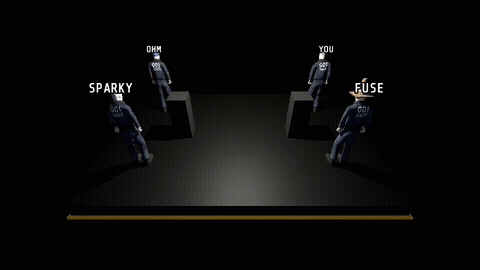
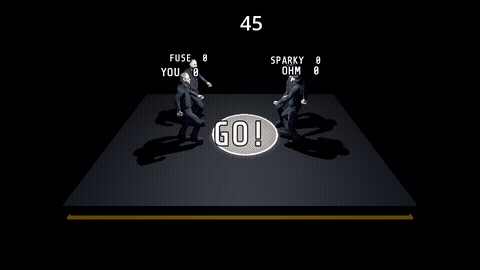

<div align="center">

# Custom Minigames for Machine Party

**Add new minigames to Machine Party.** Three demo minigames included.


*Unofficial fan mod. Not made, endorsed or supported by the game's developers or publisher.*

[**Download**](downloads/) · [**Install**](#install) · [**Teaser video**](media/machine-party-custom-minigames-teaser.mp4) · [**Make your own minigame**](docs/MODDING.md)

</div>

---

## The demo minigames

<table>
  <tr>
    <td align="center" width="33%"><br><b>⚡ Live Wire</b></td>
    <td align="center" width="33%"><br><b>🟨 Power Grid</b></td>
    <td align="center" width="33%"><br><b>🔦 Spotlight</b></td>
  </tr>
  <tr>
    <td valign="top">Hot potato with a live cable, in a high-voltage switch room. Pass it by touching someone, and don't be holding it when the fuse blows. Three arenas: <i>Classic</i>, <i>Pocket</i> and <i>Sweeper</i>.</td>
    <td valign="top">Floor panels flash amber, then go live. Each wave covers more of the floor and comes faster. Last worker standing wins.</td>
    <td valign="top">A point a second for standing in the light <i>alone</i>. Share it and nobody scores, so shove people out. Most points after 45 seconds wins.</td>
  </tr>
</table>

## Features

| | |
|---|---|
| 🎮 **Plays like the real thing** | New minigames appear in the intermission picker, the standard playlist and the lobby's playlist editor, with their own icons, briefings and taglines. Online and couch play, normal scoring. |
| 🤖 **Practice bots** | Up to three computer players for solo or couch games. They never join online matches. Playing alone? They join automatically. |
| 🔒 **Separate lobbies** | Players only match if they have the same mod and minigame versions, so normal games are never affected. |
| 🛡️ **Update-safe** | After a game update it checks everything it relies on, and switches itself off with a notice if anything changed. |
| 📦 **One-click installer** | Finds the game through Steam, keeps your settings when you update, and comes with an uninstaller. |
| 🛠️ **Build your own** | A modder's guide, with all three demos as worked examples. |

## Install

> **You need:** Machine Party on Steam (PC) and the [Machine Party Mod Loader](https://github.com/Krunk-theduck/MachinePartyModLoader) by Krunk-theduck. Install the loader first.

1. Download the zip from the [**downloads**](downloads/) folder. (Not GitHub's green *Code → Download ZIP* button: that's the source.)
2. Close the game, unzip the download and double-click **`Install.bat`**.
3. Start the game through Steam. The new minigames are in the standard playlist.

Everyone in a lobby needs the same version. To remove the mod, run **`Uninstall.bat`**. The manual steps are in [`docs/INSTALL.txt`](docs/INSTALL.txt).

<details>
<summary><b>⚙️ Settings</b></summary>

<br>

Edit these in Notepad, then restart the game. The installer keeps your choices when you update.

| File | Setting | Default | What it does |
|---|---|---|---|
| `mods/custom_minigames/settings.cfg` | `add_custom_to_standard_playlist` | `true` | Custom minigames join the standard playlist |
| | `only_custom_minigames` | `false` | Standard games play only custom minigames |
| `mods/<minigame>/settings.cfg` | `bots` | `0` | Practice bots (0–3) when no other machines are connected |
| `mods/live_wire/settings.cfg` | `arena` | `"rotate"` | `"rotate"`, `"classic"`, `"pocket"` or `"sweeper"` (keep the quotes). The host's choice counts online. |

</details>

<details>
<summary><b>🧪 Status and testing</b></summary>

<br>

Test release, built for Machine Party **v2.1.2**. Tested automatically:
- rules, bots and scoring,
- game-update safety,
- three networked game instances, including simulated bad wifi, mobile and transatlantic connections,
- full sessions through the game's own lobby, picker, briefing and score screen.

Not yet played much over Steam with real players. If something goes wrong, please share `modloader.log` and the newest `logs/godot.log` from `%APPDATA%\Godot\app_userdata\Machine Party`.

</details>

<details>
<summary><b>🛠️ For modders: repo layout and building</b></summary>

<br>

Start with [`docs/MODDING.md`](docs/MODDING.md).

| Folder | What it is |
|---|---|
| `mods/custom_minigames` | The framework: registry, wrappers around the game's playlist, picker and loader, compatibility checks |
| `mods/live_wire`, `mods/power_grid`, `mods/spotlight` | Minigame mods: manifest, settings, icon, registration (`main.gd`) |
| `content/custom_minigames_content/<key>` | Each minigame's scenes and scripts, packed into `mods/<key>/<key>.zip` |
| `installer` | `Install.bat`, `Uninstall.bat` and the PowerShell script they run (tests in `tools/installer-tests`) |
| `docs` | Player docs, changelog, credits and the modder's guide |
| `media` | Teaser video and GIFs |
| `downloads` | Ready-to-install release zip |

Build a release zip with Python 3:

```
python tools/build_release.py
```

It packs each minigame and refuses to finish if any file matches one of the game's files (`tools/game_file_hashes.json` holds hashes only, no game content).

</details>

## What's in this repo

Only original work: scripts, hand-made scenes, icons, docs and the installer. **No game files, art, audio or game code.** The minigames load the game's characters, textures and sounds at runtime from your own installed copy, so you need to own Machine Party.

## Credits

- **Built by TheCarrigan** with the help of Claude, an AI assistant made by Anthropic, which wrote most of the code. Designed, directed and play-tested by TheCarrigan.
- **Machine Party** by Mike Klubnika and GDeavid, published by Oro Interactive.
- **Machine Party Mod Loader** by Krunk-theduck.

More in [`docs/CREDITS.md`](docs/CREDITS.md).

## Licence

The mod's own code, scenes and icons are under the [MIT licence](LICENSE). Machine Party and all of its content belong to its developers and publisher and aren't covered by it.
