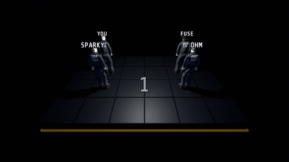

# Custom Minigames for Machine Party

**An unofficial, free fan mod that lets new minigames be added to Machine Party**, with three demo
minigames to show what it can do. Not made, endorsed or supported by the game's developers or
publisher.

  

Teaser video: [media/machine-party-custom-minigames-teaser.mp4](media/machine-party-custom-minigames-teaser.mp4)

## Install (players)

1. You need **Machine Party** on Steam (PC) and the
   [Machine Party Mod Loader](https://github.com/Krunk-theduck/MachinePartyModLoader) by Krunk-theduck.
   Install the loader first (see its page).
2. Download the latest zip from this repo's **Releases** page (not the source code).
3. Close the game, unzip the download and double-click **Install.bat**. It finds the game through
   Steam, checks the mod loader is installed and copies the mods in.
4. Start the game through Steam. Everyone in a lobby needs the same version.

To remove it, run **Uninstall.bat**. More detail and the manual steps are in `docs/INSTALL.txt`.

## What it does

- New minigames work like the built-in ones: the intermission picker, the standard playlist, the
  lobby's playlist editor, briefing pages, taglines, online and couch play, and the normal scores.
- **Practice bots** for solo or couch play (they never join online matches). Playing alone? Bots join
  automatically.
- **Separate lobbies:** players only match if they have the same mod and minigame versions, so it can't
  affect normal games.
- **Update-safe:** after a game update it checks what it relies on and switches itself off with a notice
  if anything changed.

### The demo minigames

| Minigame | In one line |
|---|---|
| **Live Wire** | Hot potato with a live cable, in a high-voltage switch room. Three arenas: Classic, Pocket and Sweeper. |
| **Power Grid** | Floor panels flash amber, then go live. Each wave covers more of the floor. |
| **Spotlight** | A point a second for standing in the light alone. Share it and nobody scores. |

Settings (bots, arena, playlist options) are in each mod's `settings.cfg`; see `docs/README.md`.

## Status

Test release. Tested with Machine Party **v2.1.2**: automated tests of the rules, bots, scoring,
update safety, three networked game instances (including simulated bad connections) and full
sessions through the game's own lobby. Not yet played much over Steam with real players. Please
report problems with your `%APPDATA%\Godot\app_userdata\Machine Party\modloader.log`.

## For modders

`docs/MODDING.md` explains how to build your own minigame on the framework. The three demos are the
worked examples.

| Folder | What it is |
|---|---|
| `mods/custom_minigames` | The framework: registry, wrappers around the game's playlist, picker and loader, compatibility checks |
| `mods/live_wire`, `mods/power_grid`, `mods/spotlight` | Minigame mods: manifest, settings, icon, registration (`main.gd`) |
| `content/custom_minigames_content/<key>` | Each minigame's scenes and scripts (packed into `mods/<key>/<key>.zip`) |
| `installer` | `Install.bat`, `Uninstall.bat` and the PowerShell script they run (tests in `tools/installer-tests`) |
| `docs` | Player docs, changelog, credits and the modder's guide |
| `media` | Teaser video and GIFs |

Build a release zip (Python 3):

```
python tools/build_release.py
```

It packs each minigame and refuses to finish if any file matches one of the game's files
(`tools/game_file_hashes.json` holds hashes only, no game content).

## What's in this repo

Only original work: scripts, hand-made scenes, icons, docs and the installer. No game files, art,
audio or game code. The minigames load the game's characters, textures and sounds at runtime from
the player's own installed copy.

## Credits

Built by Aaron with the help of Claude, an AI assistant (Anthropic), which wrote most of the code.
Designed, directed and play-tested by Aaron. Machine Party is by Mike Klubnika and GDeavid, published
by Oro Interactive. The mod loader is by Krunk-theduck. See `docs/CREDITS.md`.

## Licence

The mod's own code, scenes and icons: MIT (see `LICENSE`). Machine Party and all of its content
belong to its developers and publisher and aren't covered by this licence.
